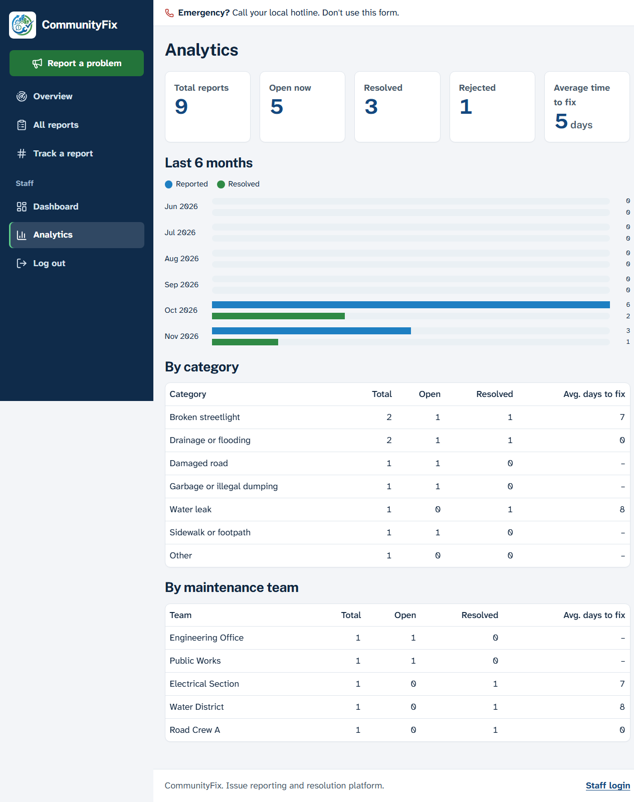

<p align="center">
  
</p>

<p align="center">
  <strong>Frontend</strong><br>
  
  
  
  
  
</p>

<p align="center">
  <strong>Backend</strong><br>
  
  
  
</p>

<p align="center">
  <strong>Database</strong><br>
  
</p>

## About CommunityFix

CommunityFix is a community problem-to-resolution tracker. Residents report broken streetlights, damaged roads, drainage problems and other local issues without creating an account, then follow each report with a tracking number until it is resolved.


## Tech stack

| Part     | Technology                                       | Used for                                     |
| -------- | ------------------------------------------------ | -------------------------------------------- |
| Frontend | Next.js 16.4, React 19.3                       | Website pages and forms                      |
|          | TypeScript 5.9                                   | Type-checked frontend code                   |
|          | Tailwind CSS 4.3, shadcn/ui                      | Styling and UI components                    |
|          | Leaflet with OpenStreetMap                       | Report maps                                  |
| Backend  | Laravel 13.40, PHP 8.3+                           | API, validation and the report workflow      |
|          | Laravel Sanctum 4.3                              | Login tokens                                 |
| Database | PostgreSQL 18                                    | Accounts, reports and update history         |

## Image credits

The sign-in page photo is [Barangay Hall of Poblacion, Alubijid](https://commons.wikimedia.org/wiki/File:Barangay_Hall_of_Poblacion,_Alubijid.jpg) by Ahri.boy, licensed under [CC BY 4.0](https://creativecommons.org/licenses/by/4.0/). It was resized and is cropped on the page.

The home page photos come from Wikimedia Commons. Those that need a credit are listed under "Photo credits" at the bottom of the home page and in `frontend/lib/photos.ts`. The others are public domain or CC0.

## Features

**Residents (account required)**
- Sign up with an email and password, or with Google, and optionally add a phone number to sign in with
- Confirm their email, recover a forgotten password, update their details, and delete their account
- Get notifications in the site when their reports change
- Edit or cancel a report until staff review it, and add messages and photos later
- Say "Me too" on a report instead of filing it again, and get its updates
- Rate the fix once a report is resolved
- Read announcements from staff
- See every report they filed under My reports
- Report a problem with a category, description, location, map pin and up to 3 photos
- Optionally leave a name, email or phone number, which only staff can see
- Get a tracking number like `CF-7K2M-9QXD`, and an email confirmation if they left an address
- Track progress with that number, and reopen a resolved report if it isn't really fixed
- Get an email when the status changes, if they left an address

**Everyone signed in**
- Browse, search and filter verified reports, see them on a map, and follow the latest activity. New reports stay hidden until staff verify them.

Visitors who aren't signed in only see the sign-in page, which shows overall figures and no report details.

**Staff (account required)**
- Dashboard with live figures and 30-day trends, a map, an activity feed and a work queue
- Verify or reject reports, and update their status with a note to the resident
- Set priority and assign a maintenance team
- Upload before-and-after photos and post public updates
- Post announcements to all residents, and see how many neighbors each report affects
- View analytics by month, category and team

**Admins**
- Everything staff can do, plus creating staff accounts, changing roles and deactivating accounts



## Status workflow

```
Reported → Verified → In progress → Resolved
    └─────────┴──→ Rejected
```

Resolving or rejecting a report requires a note. Anyone with the tracking number can send a resolved report back to Verified.

## Getting started

You need PHP 8.3+, Composer, Node.js 20+ and a PostgreSQL database. The database can be installed locally or hosted.

### 1. Backend

```bash
cd backend
composer install
cp .env.example .env
php artisan key:generate
```

Create a database named `communityfix`, then put its connection details in `backend/.env` (`DB_HOST`, `DB_PORT`, `DB_DATABASE`, `DB_USERNAME`, `DB_PASSWORD`).

```bash
php artisan migrate --seed   # --seed adds demo accounts and sample reports
php artisan storage:link
php artisan serve            # http://localhost:8000
```

### 2. Frontend

In a second terminal:

```bash
cd frontend
npm install
cp .env.example .env.local
npm run dev                  # http://localhost:3000
```

### Demo logins

Created by `--seed`, with the password `demo-password`. Log in at `/staff/login`, which is also linked from the footer.

| Role  | Email             |
| ----- | ----------------- |
| Admin | staff@example.com |
| Staff | team@example.com  |

The seeder refuses to run when `APP_ENV=production`, because these passwords are public.

To create the first real admin, run the command below. It prints a generated password. After that, admins can add staff from the website.

```bash
php artisan staff:create "Full Name" person@example.com --admin
```

## Configuration

**`backend/.env`**

| Variable          | Purpose                                                              |
| ----------------- | -------------------------------------------------------------------- |
| `DB_*`            | PostgreSQL connection                                                |
| `MAP_CENTER`      | Starting map position, as `lat,lng`                                  |
| `FILESYSTEM_DISK` | Where photos are stored: `public` for local files, `s3` for a bucket |
| `FRONTEND_URL`    | Address of the website, used in email links                          |
| `MAIL_*`          | How email is sent                                                    |
| `INTERNAL_API_KEY` | Shared with the website, so rate limits see each visitor's address  |

Locally, `MAIL_MAILER=log` writes emails to `backend/storage/logs/laravel.log` instead of sending them, so you can read them, or open a password reset link, from there.

**`frontend/.env.local`**

| Variable  | Purpose                                     |
| --------- | ------------------------------------------- |
| `API_URL` | Address of the Laravel API, ending in `/api` |
| `INTERNAL_API_KEY` | Must match the value in `backend/.env` |

## How login works

Only staff log in. The browser only talks to Next.js. On login, a Next.js Server Action receives a Sanctum token from Laravel and stores it in an httpOnly cookie, so JavaScript in the browser cannot read it. Next.js then attaches the token to its requests to Laravel. This lets the frontend and API run on different domains.

## Limits

| Action                | Limit                                                  |
| --------------------- | ------------------------------------------------------ |
| New reports           | 10 an hour per visitor, 200 an hour across the site    |
| Tracking lookups      | 30 a minute per visitor                                |
| Staff login and reset | 10 a minute per email                                  |
| Photos                | 3 per report, 4 MB each, JPEG, PNG or WebP             |

The report form also has a hidden field that catches simple bots.

## Deployment

The API deploys to [Render](https://render.com) from `render.yaml`, using `backend/Dockerfile`. The website deploys to [Vercel](https://vercel.com) with `frontend` as its root directory, `API_URL` set to the API address, and `INTERNAL_API_KEY` matching the API.

In production you also need:

- A hosted PostgreSQL database, set as `DB_URL`
- S3-compatible storage for photos, because Render's free plan deletes local files
- An email provider's SMTP login, for tracking confirmations, status emails and password resets

Secrets are entered in Render's dashboard, not in this repository. Create `APP_KEY` with `php artisan key:generate --show`.

## Tests

```bash
cd backend
php artisan test             # uses in-memory SQLite, so no database setup is needed

cd frontend
npx next typegen && npx tsc --noEmit
npm run lint
```

## Project layout

```
backend/
  app/Console/Commands/      Command-line tools (staff:create)
  app/Enums/                 Statuses, categories, priorities and allowed status moves
  app/Http/Controllers/Api/  One small controller per area of the API
  app/Providers/             Staff and admin permissions, and rate limits
  app/Http/Middleware/       Rejects text the database can't store
  app/Http/Requests/         Validation rules and error messages
  app/Http/Resources/        JSON output, including what the public may see
  app/Models/                Database models, tracking numbers and search filters
  app/Notifications/         Emails sent to residents
  app/Services/              Report workflow rules and statistics
  database/                  Migrations, factories and demo data
  docker/                    Production start script and PHP settings
  routes/api.php             API routes, grouped by who can use them
  tests/Feature/             API tests
frontend/
  app/(site)/                Public pages and the staff dashboard
  app/staff/                 Separate staff portal: login and password reset
  app/actions.ts             Server Actions
  components/                Forms, maps and shared UI
  lib/api.ts                 Server-side API client
docs/                        README images
render.yaml                  Render deployment settings
```
