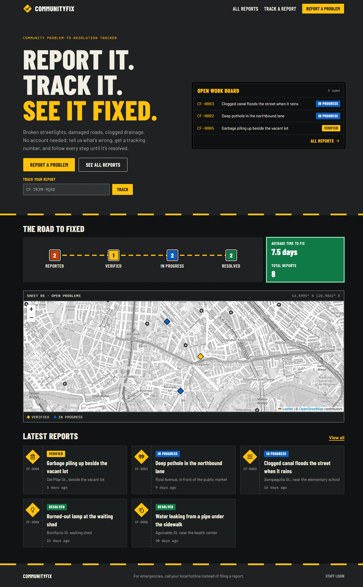
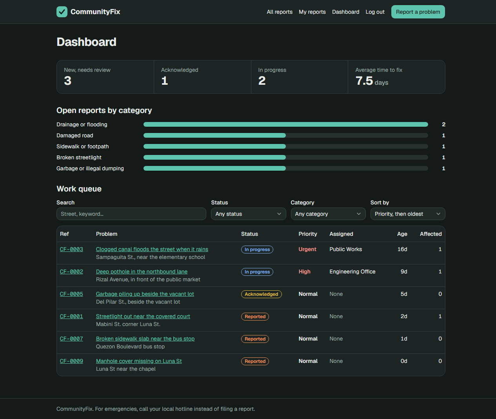

<p align="center">
  <picture>
    <source media="(prefers-color-scheme: dark)" srcset="docs/logo-dark.svg">
    
  </picture>
</p>

<p align="center">
  <strong>Frontend</strong><br>
  
  
  
  
  
</p>

<p align="center">
  <strong>Backend</strong><br>
  
  
  
</p>

<p align="center">
  <strong>Database</strong><br>
  
</p>

## About CommunityFix

CommunityFix is a community problem-to-resolution tracker. Residents report broken streetlights, damaged roads, drainage problems and other local issues, then follow each report until it is resolved.



## Tech stack

| Part     | Technology                                       | Used for                                     |
| -------- | ------------------------------------------------ | -------------------------------------------- |
| Frontend | Next.js 16.4, React 19.3                       | Website pages and forms                      |
|          | TypeScript 5.9                                   | Type-checked frontend code                   |
|          | Tailwind CSS 4.3, shadcn/ui                      | Styling and UI components                    |
|          | Leaflet with OpenStreetMap                       | Report maps                                  |
| Backend  | Laravel 13.40, PHP 8.3+                           | API, validation and the report workflow      |
|          | Laravel Sanctum 4.3                              | Login tokens                                 |
| Database | PostgreSQL 18                                    | Accounts, reports and update history         |

## Features

**Residents**
- Report a problem with a category, description, address, map pin and photo
- Follow progress on a status tracker and an update history
- Comment on reports and mark "This affects me too"
- Reopen a resolved report if the problem is not actually fixed
- Get an email when staff change a report's status
- Reset a forgotten password by email

**Staff**
- Dashboard with a work queue, open counts and average time to fix
- Move reports through the workflow, with a note to the resident
- Set priority and assign a department

**Public**
- Anyone can browse, search and filter reports and see them on a map, without an account. Resident names are hidden from the public.



## Status workflow

```
Reported → Acknowledged → In progress → Resolved
    └───────────┴──→ Rejected
```

Resolving or rejecting a report requires a note. The reporter can send a resolved report back to Acknowledged.

## Getting started

You need PHP 8.3+, Composer, Node.js 20+ and a PostgreSQL database. The database can be installed locally or hosted.

### 1. Backend

```bash
cd backend
composer install
cp .env.example .env
php artisan key:generate
```

Create a database named `communityfix`, then put its connection details in `backend/.env` (`DB_HOST`, `DB_PORT`, `DB_DATABASE`, `DB_USERNAME`, `DB_PASSWORD`).

```bash
php artisan migrate --seed   # --seed adds demo accounts and sample reports
php artisan storage:link
php artisan serve            # http://localhost:8000
```

### 2. Frontend

In a second terminal:

```bash
cd frontend
npm install
cp .env.example .env.local
npm run dev                  # http://localhost:3000
```

### Demo logins

Created by `--seed`, with the password `demo-password`:

| Role     | Email                |
| -------- | -------------------- |
| Staff    | staff@example.com    |
| Resident | resident@example.com |

The seeder refuses to run when `APP_ENV=production`, because these passwords are public.

To add a real staff account, run the command below. It prints a generated password.

```bash
php artisan staff:create "Full Name" person@example.com
```

## Configuration

**`backend/.env`**

| Variable          | Purpose                                                              |
| ----------------- | -------------------------------------------------------------------- |
| `DB_*`            | PostgreSQL connection                                                |
| `MAP_CENTER`      | Starting map position, as `lat,lng`                                  |
| `FILESYSTEM_DISK` | Where photos are stored: `public` for local files, `s3` for a bucket |
| `FRONTEND_URL`    | Address of the website, used in email links                          |
| `MAIL_*`          | How email is sent                                                    |

Locally, `MAIL_MAILER=log` writes emails to `backend/storage/logs/laravel.log` instead of sending them, so you can open a password reset link from there.

**`frontend/.env.local`**

| Variable  | Purpose                                     |
| --------- | ------------------------------------------- |
| `API_URL` | Address of the Laravel API, ending in `/api` |

## How login works

The browser only talks to Next.js. On login, a Next.js Server Action receives a Sanctum token from Laravel and stores it in an httpOnly cookie, so JavaScript in the browser cannot read it. Next.js then attaches the token to its requests to Laravel. This lets the frontend and API run on different domains.

## Limits

| Action                     | Limit                       |
| -------------------------- | --------------------------- |
| Login, sign-up, reset      | 10 a minute per email       |
| New reports                | 10 an hour per account      |
| Comments and "affects me"  | 30 a minute per account     |
| Photos                     | 4 MB, JPEG, PNG or WebP     |

## Deployment

The API deploys to [Render](https://render.com) from `render.yaml`, using `backend/Dockerfile`. The website deploys to [Vercel](https://vercel.com) with `frontend` as its root directory and `API_URL` set to the API address.

In production you also need:

- A hosted PostgreSQL database, set as `DB_URL`
- S3-compatible storage for photos, because Render's free plan deletes local files
- An email provider's SMTP login, for password resets and status emails

Secrets are entered in Render's dashboard, not in this repository. Create `APP_KEY` with `php artisan key:generate --show`.

## Tests

```bash
cd backend
php artisan test             # uses in-memory SQLite, so no database setup is needed

cd frontend
npx next typegen && npx tsc --noEmit
npm run lint
```

## Project layout

```
backend/
  app/Console/Commands/      Command-line tools (staff:create)
  app/Enums/                 Statuses, categories, priorities and allowed status moves
  app/Http/Controllers/Api/  One small controller per area of the API
  app/Http/Middleware/       Rejects text the database can't store
  app/Http/Requests/         Validation rules and error messages
  app/Http/Resources/        JSON output, including what the public may see
  app/Models/                Database models and search filters
  app/Notifications/         Emails sent to residents
  app/Policies/              Who is allowed to do what
  app/Services/              Report workflow rules and statistics
  database/                  Migrations, factories and demo data
  docker/                    Production start script and PHP settings
  routes/api.php             API routes
  tests/Feature/             API tests
frontend/
  app/                       Pages and Server Actions (actions.ts)
  components/                Forms, maps and shared UI
  lib/api.ts                 Server-side API client
docs/                        README images
render.yaml                  Render deployment settings
```
